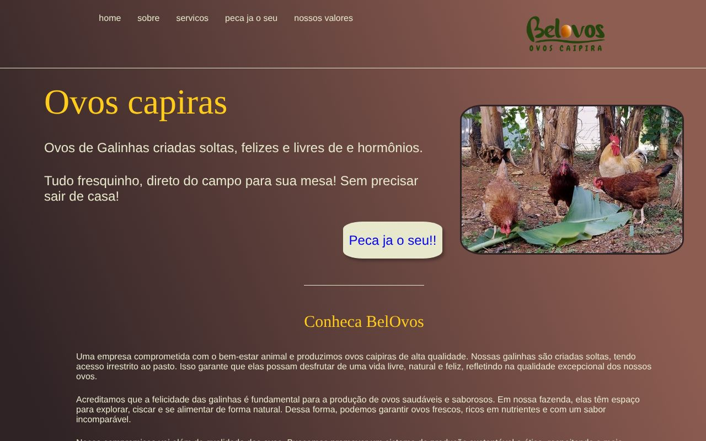

# 🥚 BelOvos – Website for a free-range egg business

A website I designed and built for **BelOvos**, my family's free-range egg business in Brazil. The site presents the brand, explains how the hens are raised and lets customers order directly on WhatsApp.

## ✨ Pages

- **Home:** the main message and an "order now" button that opens WhatsApp
- **Sobre (About):** the story and values behind the business
- **Serviços (Services):** what BelOvos offers
- **Nossos valores (Our values):** animal welfare and sustainability
- **Peça já o seu (Order):** a form for customers to sign up

## 🛠 Built with

HTML · CSS

## 💼 Why it matters

This was a real project for a real business. I planned the content, wrote the text in Portuguese for local customers and connected the site to WhatsApp, which is how most customers in Brazil prefer to order.

> The website text is in Portuguese because the customers are in Brazil.
